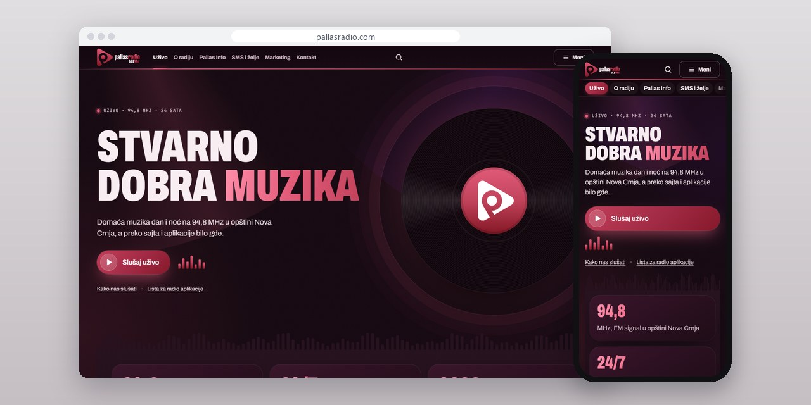
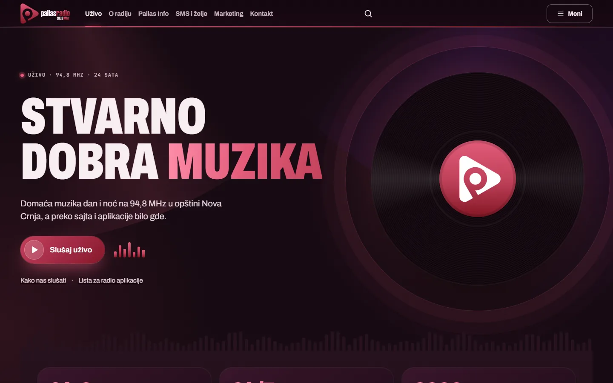
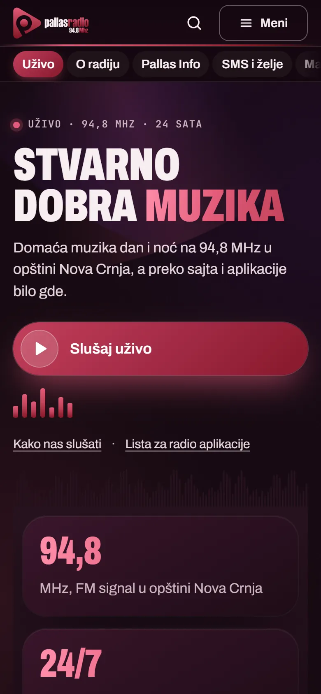
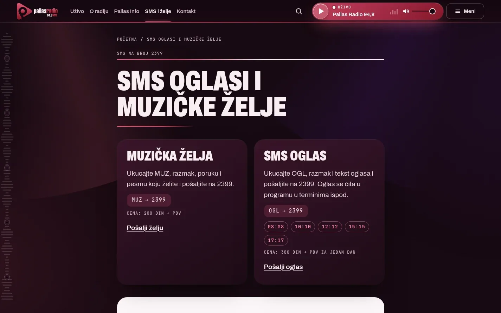
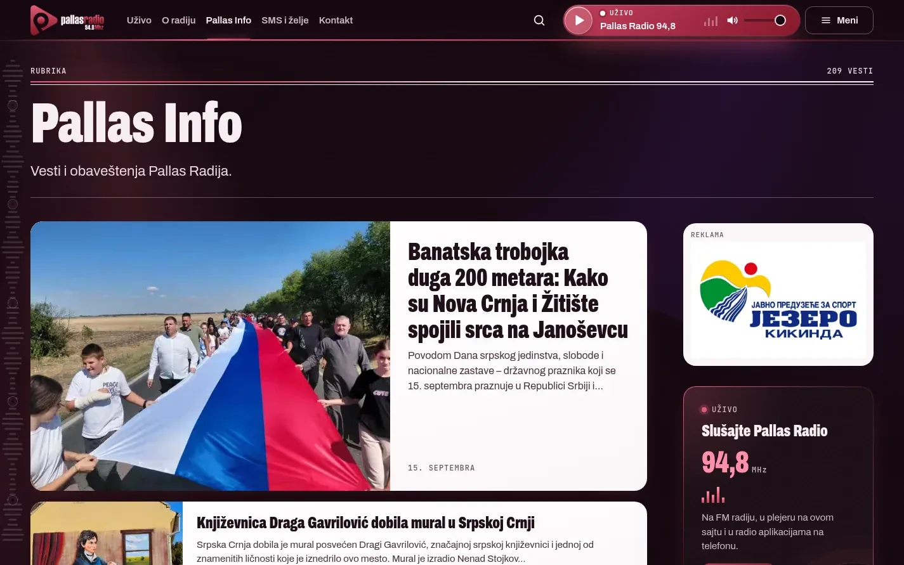

# Pallas Radio

Site for a radio station on 94.8 MHz: a big live player with a record that spins only while it plays, SMS requests and ads, and old playlists that still work.

**[pallasradio.com](https://www.pallasradio.com/)** · [Case study (in Serbian)](https://svilenkovic.rs/radovi/pallas-radio) · [Srpski](README.sr.md)

> [!NOTE]
> Client project. The source code belongs to the client and stays in a private repository. This page describes what I built and how.

<table>
  <tr><td><b>Client</b></td><td>Pallas production doo</td></tr>
  <tr><td><b>Industry</b></td><td>Radio station playing domestic music</td></tr>
  <tr><td><b>Location</b></td><td>Kikinda, Serbia</td></tr>
  <tr><td><b>Type</b></td><td>Radio station website (PWA)</td></tr>
  <tr><td><b>My role</b></td><td>Redesign, development, migration, hosting and maintenance</td></tr>
  <tr><td><b>Stack</b></td><td>PHP 8.3, MariaDB, Redis, nginx, PWA</td></tr>
</table>

## About the project

Pallas Radio plays domestic music on 94.8 MHz for the municipality of Nova Crnja, under the slogan "Stvarno dobra muzika" (really good music). The programme comes first here, so I made a radio website rather than a news portal. Whoever opens it sees the player first, with SMS requests and ads right below.

It runs on the same platform as the Radio AMI and Ami Naxi portals, with its own page layout and a dark night-stage look in the raspberry and burgundy of the logo. The home page opens with a big live player and a vinyl record that spins only while the stream plays; on other pages the player moves to the header and keeps going. Listeners who set up Pallas in Winamp, VLC or a radio app through the old /play/?pl= playlist addresses did not have to change anything, because those addresses still return the playlist.

## What I built

- A big live player on the home page with a record that spins only while the programme plays, moving to the header on other pages
- A page for SMS ads and music requests that says what to type, where to send it and when the ads are read on air
- Pallas Info with 209 posts moved from the old site, 25 redirects from old addresses and a sponsor banner
- Old /play/?pl= playlist addresses kept for external players, next to new M3U and PLS lists
- A contact form through my central form service, a link to the station's Facebook page, an editorial panel installed as its own PWA and a public PWA
- Mobile PageSpeed 98, with accessibility, best practices and SEO at 100, measured on 17 October 2026

## Results

| | Performance | Accessibility | Best practices | SEO |
| :-- | :-: | :-: | :-: | :-: |
| Mobile | 98 | 100 | 100 | 100 |
| Desktop | 100 | 100 | 100 | 100 |

PageSpeed Insights, lab test of the live site, October 2026. Security headers: 6 of 6. axe accessibility check: no violations. Structured data: `BroadcastService`, `NewsMediaOrganization`, `RadioStation`.

## Screenshots

<table>
  <tr>
    <td width="68%" valign="top"></td>
    <td width="32%" valign="top"></td>
  </tr>
</table>

SMS requests and ads, with what to send and when ads are read on air

Pallas Info: news on light cards, a sponsor banner and the player at the side

---

Built by [D. Svilenković](https://svilenkovic.com).
